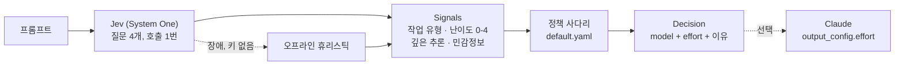

# token-saver

[](https://github.com/minBuild/token-saver/actions/workflows/ci.yml)


프롬프트마다 **그 일을 감당할 수 있는 가장 싼 Claude 모델과 effort 수준**을 골라 줍니다.
판단은 TypeSafe의 System One 결정 모델인 [Jev](https://docs.typesafe.ai)가 한 번의 호출로
수백 밀리초 안에, 1센트의 수백분의 1 비용으로 내리고, 실제 작업은 Claude가 알맞은 크기로 합니다.

[English README](README.md)

```text
$ token-saver route "Design a rate limiter for a public API across 12 regions and compare token bucket vs sliding window"
claude-opus-5-5 @ xhigh  (tier: hard)
  task        analysis  (confidence 0.37)
  difficulty  2.70 -> level 3  (confidence 0.75)
  reasoning   0.80   sensitive 0.05
  source      heuristic  0 ms
  why         difficulty 2.70 rounds to level 3 -> hard
              task type analysis confidence 0.37 < 0.5 -> floors and ceilings skipped

$ token-saver route "이 문장을 영어로 번역해줘: 회의는 목요일 오후 3시로 변경되었습니다."
claude-sonnet-5-5 @ high  (tier: simple)
  ...
```

## 왜 만들었나

대부분의 Claude 연동은 모델 하나, effort 하나를 모든 요청에 씁니다. "안녕"도 "멀티 리전 결제
시스템 설계"도 똑같이 Opus에 xhigh로 갑니다. 이제 effort는 모든 현행 모델에서 API 파라미터
(`output_config.effort`, `low`부터 `max`까지)로 열려 있으니, "충분히 싼 설정"은 모델과 사고
깊이라는 두 축의 선택이 되었습니다.

이 선택을 LLM 분류기로 하면 프롬프트마다 모델 호출이 한 번 더 듭니다. Jev는 이런 결정을 위해
만들어진 모델입니다. 텍스트를 생성하지 않고 타입이 정해진 질문에 답합니다. 보기별 확률이 있는
선택(choice), 설명된 단계에 대한 점수(score), 예/아니오 확률(noul)을 한 요청에서 돌려줍니다.
LiteLLM의 auto-router 벤치마크에서는 Haiku 4.5 분류기보다 5배 빠르고 비용은 4%, 라벨 일치율은
더 높았습니다([벤더 측 벤치마크](https://docs.litellm.ai/blog/jev-auto-router-benchmark),
프롬프트 80개이므로 참고 수준). 요금은 입력 100만 토큰당 $0.042이고, 보통 길이의 프롬프트 한
번 분류에 0.001센트가 채 안 듭니다.

## 동작 방식



**Jev 호출 한 번에 질문 네 개.** System One 요청 안의 질문들은 병렬로 평가되므로, 네 개를
물어도 지연은 하나 물을 때와 거의 같습니다.

| 질문 | 타입 | 묻는 것 |
|---|---|---|
| `task_type` | choice | chitchat · factual · rewrite · coding · analysis · creative · agentic |
| `difficulty` | score | "trivial"부터 "expert"까지 *상황으로 설명한* 5단계. 확률 가중 평균이라 2.3 같은 값이 나옵니다 |
| `deep_reasoning` | noul | 신중한 전문가라면 답하기 전에 여러 단계를 생각해야 하는가? |
| `sensitive` | noul | 비밀키나 개인정보가 들어 있는가 (플래그로만 보고하고 라우팅에는 쓰지 않음) |

**조회표가 아니라 사다리.** 난이도 단계가 출발 티어를 정하고, 규칙들이 위아래로 옮깁니다.
발동한 규칙마다 Decision에 이유가 남습니다.

| 단계 | 티어 | 모델 | effort | 용도 |
|---|---|---|---|---|
| 0 | trivial | `claude-haiku-5-5` | high | 한 줄 답, 잡담, 단순 조회 |
| 1 | simple | `claude-sonnet-5-5` | high | 한 단계짜리 작업, 짧은 교정, 작은 코드 조각 |
| 2 | moderate | `claude-sonnet-5-5` | xhigh | 몇 단계의 추론, 설계 판단이 들어가는 중간 크기 코드 |
| 3 | hard | `claude-opus-5-5` | xhigh | 다단계 추론, 컴포넌트를 넘나드는 디버깅, 실제 트레이드오프 |
| 4 | expert | `claude-fable-5-1` | xhigh | 연구 수준의 깊이, 큰 설계, 틀리면 비싼 정확성 |

규칙은 이 순서로 적용됩니다.

1. **확신이 낮으면 올립니다.** 난이도 confidence가 0.35 미만이면 한 티어 위로. 싸게 틀리는 것이
   조금 비싸게 맞는 것보다 비쌉니다.
2. **깊은 추론에는 바닥이 있습니다.** 여러 단계의 사고가 필요할 확률이 0.7을 넘으면 `hard`
   아래로는 내려가지 않습니다.
3. **작업 유형별 바닥과 천장**은 작업 유형 confidence가 0.5 이상일 때만 적용됩니다. coding은
   `simple` 이상, analysis는 `moderate` 이상, agentic은 `hard` 이상. chitchat은 `trivial` 이하,
   factual은 `moderate` 이하. 천장은 마지막에 적용되므로 항상 이깁니다.

위 내용은 전부 [`src/token_saver/policies/default.yaml`](src/token_saver/policies/default.yaml)에
있습니다. 복사해서 고친 뒤 `--policy`나 `Policy.load()`로 넘기면 되고, 오타는 즉시 오류로 잡힙니다.

**장애 시에는 열린 쪽으로 실패합니다.** Jev에 닿지 않거나, 레이트 리밋에 걸리거나, 키가 없으면
오프라인 휴리스틱(단어 수, 코드 표식, 영어·한국어 키워드 목록)이 같은 네 질문에 답하고, Decision에
폴백이 일어났다는 사실이 기록됩니다. `--strict`를 주면 대신 오류를 냅니다.

## 빠른 시작

```bash
pip install git+https://github.com/minBuild/token-saver.git
export TYPESAFE_API_KEY=...      # https://console.typesafe.ai/keys  (없으면 휴리스틱으로 라우팅)

token-saver route "이 문단을 한 문장으로 요약해줘: ..."
token-saver route - < prompt.txt --json
token-saver policy
```

프롬프트를 *실행*까지 맡기려면 선택 의존성인 Anthropic SDK를 설치합니다. 답은 stdout으로,
라우팅과 사용량 메모는 stderr로 나가므로 파이프에 그대로 물릴 수 있습니다.

```bash
pip install "token-saver[claude] @ git+https://github.com/minBuild/token-saver.git"
export ANTHROPIC_API_KEY=...

token-saver run "낙관적 잠금과 비관적 잠금의 차이를 설명해줘"
# [token-saver] claude-sonnet-5-5 @ xhigh  (tier: moderate, classifier: jev)
# ...답이 스트리밍으로 출력...
# [token-saver] answered by claude-sonnet-5-5  in 231 / out 612 tokens  cost $0.0066
```

라이브러리로 쓸 때:

```python
from token_saver import route

decision = route("Translate to Korean: the meeting moved to Thursday 3 pm")
decision.model, decision.effort, decision.tier   # ('claude-sonnet-5-5', 'high', 'simple')
decision.reasons                                  # ('difficulty 1.10 rounds to level 1 -> simple',)
decision.signals.task_type_probabilities          # {'rewrite': 0.91, 'factual': 0.04, ...}
```

```python
from token_saver import Policy, Router
from token_saver.classifiers import JevClassifier
from token_saver.executor import ClaudeExecutor

router = Router(JevClassifier(model="jev-1.13.0"), Policy.load("my-policy.yaml"))
decision = router.route(prompt)

result = ClaudeExecutor(system="짧게 답해.").run(prompt, decision, on_text=print)
result.model, result.input_tokens, result.output_tokens, result.cost_usd
```

`ClaudeExecutor`는 Decision의 `output_config.effort`를 그대로 보내고, thinking은 API 기본값
(adaptive)으로 두며, 지원 모델에서는 서버 측 fallback을 켜서 안전 거절이 나면 같은 호출 안에서
대체 모델로 재시도합니다. 실제로 답한 모델은 `result.model`로 알 수 있습니다.

## 벤치마크

[`bench/prompts.jsonl`](bench/prompts.jsonl)에는 티어별 10개씩, 절반은 한국어인 라벨링된
프롬프트 50개가 있습니다. `token-saver bench`는 전부 라우팅해서 고른 티어를 라벨과 비교하고,
"전부 한 설정으로 보냈을 때"를 기준선으로 비용을 계산합니다.

```bash
token-saver bench --classifier heuristic --markdown --out bench/results/heuristic.md
token-saver bench --classifier jev --fixtures bench/fixtures/jev.json --record --markdown --out bench/results/jev.md
token-saver bench --classifier fixture --fixtures bench/fixtures/jev.json      # 재생, 네트워크 없음
```

제품이 아니라 폴백인 오프라인 휴리스틱의 점수는 다음과 같습니다
([전체 리포트](bench/results/heuristic.md)).

| 지표 | 휴리스틱 |
|---|---|
| 티어 정확 일치 | 48% (24/50) |
| 한 티어 이내 | 88% (44/50) |
| 추정 Claude 비용, 라우팅 | $0.41 |
| 추정 Claude 비용, 기준선 (`claude-opus-5-5` @ xhigh) | $0.81 |
| 기준선 대비 절감 | 49% |

Jev 수치는 아직 없습니다. TypeSafe가 2026년 9월 말 신규 가입을 일시 중단해 이 저장소는 키 없이
만들어졌습니다. 위의 기록 명령은 Jev의 원본 응답을 전부 fixture 파일에 저장하므로, 키가 생기면
Jev 실행 결과를 커밋해 오프라인에서 재현할 수 있고 표도 실제 데이터로 갱신할 수 있습니다.

추정이 다루는 것과 다루지 않는 것: [`pricing.py`](src/token_saver/pricing.py)에 날짜와 함께
적힌 정가에, 대략적인 입력 토큰 수와 요청당 800 출력 토큰 가정을 곱합니다. 캐시된 토큰은 입력
가격으로 계산하고 thinking 토큰은 모델링하지 않으므로, 토큰 단가 쪽은 상한이고 effort 쪽은 추정
자체를 하지 않습니다. `token-saver run`은 API 응답의 실제 사용량을 보고합니다.

## 설계 메모

- **confidence는 두 번째 결정 축입니다.** Jev는 확률 분포를 돌려주고 `confidence`는 그 분포가
  얼마나 뾰족한지를 요약합니다. 정책은 이를 두 번 씁니다. 난이도 confidence가 낮으면 올리고,
  작업 유형 confidence가 낮으면 유형별 바닥·천장을 끕니다. TypeSafe의
  [confidence-gated routing](https://docs.typesafe.ai/patterns/confidence-routing) 패턴을 따랐습니다.
- **단계는 정도가 아니라 상황으로 씁니다.** score 질문은 각 단계 설명을 독립적으로 대조하므로
  "조금 어려움"보다 "Hard: 다단계 추론, 컴포넌트를 넘나드는 디버깅, 실제 트레이드오프"가 잘 맞습니다.
- **정책은 데이터입니다.** 모델, effort, 임계값, 바닥·천장은 YAML이고 코드는 티어가 순서를 갖는다는
  것만 압니다. 임계값을 튜닝한 뒤에는 `jev-latest` 대신 `jev-1.13.0`처럼 버전을 고정하세요.
  별칭은 움직입니다.
- **비용은 정직하거나 없습니다.** 모르는 모델은 추측값 대신 가격 없음으로 처리합니다.
- **테스트는 네트워크를 전혀 쓰지 않습니다.** Jev는 실제 SDK 클라이언트에 `httpx2.MockTransport`를
  꽂아 검증하고, Claude는 가짜 클라이언트로 검증합니다.

## 한계

- Jev의 주 학습 언어는 영어이고 CJK는 정확도가 낮습니다. 그래서 프롬프트 세트의 절반을 한국어로
  두었습니다. 한국어 라우팅을 믿기 전에 실제 수치를 먼저 기록하세요.
- 프롬프트가 분류를 위해 TypeSafe로 전송됩니다. 제3자와 공유할 수 없는 텍스트는 라우팅하지 마세요.
  `sensitive` 플래그는 로깅용 힌트이지 방어막이 아닙니다.
- 답할 수 *있는* 가장 싼 티어가 *완료된 작업당* 가장 싼 것은 아닙니다. 더 새로운 모델의 낮은
  effort가 더 작은 모델의 높은 effort보다 나을 때가 있고, 재시도가 필요한 싼 답은 싸지 않습니다.
  추정을 믿기 전에 `run`으로 실제 트래픽에서 측정하세요.
- 가격, 모델 ID, effort의 의미는 바뀝니다. 가격표에는 날짜가 있고 정책은 직접 고치는 것입니다.

## 개발

```bash
python -m venv .venv && source .venv/bin/activate     # Windows: .venv\Scripts\activate
pip install -e ".[dev]"
ruff check src tests && ruff format --check src tests && mypy && pytest
```

```text
src/token_saver/
  signals.py          질문 네 개와 Signals 데이터클래스
  confidence.py       TypeSafe의 confidence 공식 (휴리스틱과 테스트용)
  classifiers/        jev.py (실호출), heuristic.py (오프라인), fixture.py (기록·재생)
  policy.py           사다리, 규칙, YAML 로더
  policies/default.yaml
  router.py           분류기 + 정책 + 폴백
  pricing.py          정가표와 비용 추정
  executor.py         Decision대로 Claude 실행
  bench.py, cli.py
bench/prompts.jsonl   라벨링된 프롬프트 50개
tests/                테스트 121개, 전부 오프라인
```

## 로드맵

- Jev 결과 기록과 Jev 버전별 임계값 튜닝
- 비동기 라우터와 일괄 분류
- 프롬프트마다 `/model`과 `/effort`를 제안하는 Claude Code 훅
- 투명하게 라우팅하는 OpenAI 호환 프록시 모드

## 라이선스

MIT
