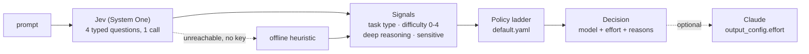

# token-saver

[](https://github.com/minBuild/token-saver/actions/workflows/ci.yml)


Route every prompt to the cheapest Claude model and effort level that can handle it.
A single call to [Jev](https://docs.typesafe.ai), TypeSafe's System One decision model, judges
the prompt in a few hundred milliseconds for a fraction of a cent; Claude then does the work at
the right size.

[한국어 README](README.ko.md)

```text
$ token-saver route "Design a rate limiter for a public API across 12 regions and compare token bucket vs sliding window"
claude-opus-5-5 @ xhigh  (tier: hard)
  task        analysis  (confidence 0.37)
  difficulty  2.70 -> level 3  (confidence 0.75)
  reasoning   0.80   sensitive 0.05
  source      heuristic  0 ms
  why         difficulty 2.70 rounds to level 3 -> hard
              task type analysis confidence 0.37 < 0.5 -> floors and ceilings skipped

$ token-saver route "이 문장을 영어로 번역해줘: 회의는 목요일 오후 3시로 변경되었습니다."
claude-sonnet-5-5 @ high  (tier: simple)
  ...
```

## Why

Most Claude integrations pick one model and one effort for everything, so "hi" gets the same
Opus-at-xhigh treatment as "design a multi-region payments system". Effort is now a first-class
API knob (`output_config.effort`, `low` to `max`) on every current model, which means the
cheapest adequate configuration is a two-dimensional choice: which model, and how hard it
should think.

Deciding that with an LLM classifier costs a full model call per prompt. Jev is built for this
kind of decision: instead of generating text it answers typed questions (a choice with a
probability per option, a score on described levels, a yes/no probability) in one request.
In LiteLLM's auto-router benchmark it classified prompts 5x faster than Haiku 4.5 at 4% of the
cost, with higher agreement with the labels ([vendor-run benchmark](https://docs.litellm.ai/blog/jev-auto-router-benchmark),
80 prompts, so read it as an indication rather than a result). Jev bills $0.042 per million
input tokens; a classification of a typical prompt costs well under a thousandth of a cent.

## How it works



**One Jev call, four questions.** Questions in a System One request run in parallel, so asking
four costs about the same latency as asking one.

| question | type | what it asks |
|---|---|---|
| `task_type` | choice | chitchat · factual · rewrite · coding · analysis · creative · agentic |
| `difficulty` | score | five *described* levels from "trivial" to "expert"; the answer is probability-weighted, so it can be 2.3 |
| `deep_reasoning` | noul | would a careful expert need several steps of thought before answering well? |
| `sensitive` | noul | secrets or personal data present (reported as a flag, never used for routing) |

**A ladder, not a lookup.** The difficulty level picks a starting tier; the rules then move the
pick up or down and each one that fires leaves a reason on the decision.

| level | tier | model | effort | meant for |
|---|---|---|---|---|
| 0 | trivial | `claude-haiku-5-5` | high | one-line answers, small talk, lookups |
| 1 | simple | `claude-sonnet-5-5` | high | single-step work, short rewrites, small snippets |
| 2 | moderate | `claude-sonnet-5-5` | xhigh | a few steps of reasoning, medium code with design choices |
| 3 | hard | `claude-opus-5-5` | xhigh | multi-step reasoning, cross-component debugging, real trade-offs |
| 4 | expert | `claude-fable-5-1` | xhigh | research-level depth, large designs, correctness that is costly to get wrong |

Rules, in the order they apply:

1. **Low confidence escalates.** If Jev's confidence in the difficulty is below 0.35, go one tier
   up. A wrong cheap answer costs more than a slightly dearer right one.
2. **Deep reasoning has a floor.** If the probability that the prompt needs several steps of
   thought is above 0.7, never go below `hard`.
3. **Task types have floors and ceilings**, applied only when the task-type confidence is at least
   0.5: coding never below `simple`, analysis never below `moderate`, agentic never below `hard`;
   chitchat never above `trivial`, factual never above `moderate`. Ceilings apply last, so they win.

Everything above lives in [`src/token_saver/policies/default.yaml`](src/token_saver/policies/default.yaml).
Copy it, edit it, pass it with `--policy` or `Policy.load()`. A typo in the file fails loudly.

**It fails open.** If Jev is unreachable, rate limited or not configured, an offline heuristic
(word counts, code markers, English and Korean keyword lists) answers the same four questions and
the decision records that a fallback happened. `--strict` turns that into an error instead.

## Quick start

```bash
pip install git+https://github.com/minBuild/token-saver.git
export TYPESAFE_API_KEY=...      # https://console.typesafe.ai/keys  (omit it and the heuristic routes)

token-saver route "Summarize this paragraph in one sentence: ..."
token-saver route - < prompt.txt --json
token-saver policy
```

To let token-saver also *run* the prompt, install the optional Anthropic SDK extra. The answer
goes to stdout and the routing and usage notes to stderr, so it pipes cleanly.

```bash
pip install "token-saver[claude] @ git+https://github.com/minBuild/token-saver.git"
export ANTHROPIC_API_KEY=...

token-saver run "Explain the difference between optimistic and pessimistic locking"
# [token-saver] claude-sonnet-5-5 @ xhigh  (tier: moderate, classifier: jev)
# ...the answer, streamed...
# [token-saver] answered by claude-sonnet-5-5  in 231 / out 612 tokens  cost $0.0066
```

As a library:

```python
from token_saver import route

decision = route("Translate to Korean: the meeting moved to Thursday 3 pm")
decision.model, decision.effort, decision.tier   # ('claude-sonnet-5-5', 'high', 'simple')
decision.reasons                                  # ('difficulty 1.10 rounds to level 1 -> simple',)
decision.signals.task_type_probabilities          # {'rewrite': 0.91, 'factual': 0.04, ...}
```

```python
from token_saver import Policy, Router
from token_saver.classifiers import JevClassifier
from token_saver.executor import ClaudeExecutor

router = Router(JevClassifier(model="jev-1.13.0"), Policy.load("my-policy.yaml"))
decision = router.route(prompt)

result = ClaudeExecutor(system="Answer briefly.").run(prompt, decision, on_text=print)
result.model, result.input_tokens, result.output_tokens, result.cost_usd
```

`ClaudeExecutor` sends `output_config.effort` from the decision, leaves thinking at the API
default (adaptive), and opts into server-side fallbacks on the models that support them so a
safety refusal is retried on a substitute model inside the same call. `result.model` tells you
who actually answered.

## Benchmark

[`bench/prompts.jsonl`](bench/prompts.jsonl) holds 50 labelled prompts, ten per tier, half of
them in Korean. `token-saver bench` routes all of them, compares the picked tier with the label,
and prices the outcome against a baseline of sending everything to one configuration.

```bash
token-saver bench --classifier heuristic --markdown --out bench/results/heuristic.md
token-saver bench --classifier jev --fixtures bench/fixtures/jev.json --record --markdown --out bench/results/jev.md
token-saver bench --classifier fixture --fixtures bench/fixtures/jev.json      # replay, no network
```

The offline heuristic, which is the fallback and not the product, scores like this
([full report](bench/results/heuristic.md)):

| metric | heuristic |
|---|---|
| exact tier match | 48% (24/50) |
| within one tier | 88% (44/50) |
| estimated Claude spend, routed | $0.41 |
| estimated Claude spend, baseline (`claude-opus-5-5` @ xhigh) | $0.81 |
| savings vs baseline | 49% |

Jev numbers are not in this table yet: TypeSafe paused new sign-ups in late September 2026 and
this repository was built without a key. The recording command above writes every raw Jev
response into a fixture file that can be committed, so once a key is available the Jev run is
reproducible offline and the table can be refreshed with real data.

What the estimate does and does not cover: it multiplies list prices (dated in
[`pricing.py`](src/token_saver/pricing.py)) by a rough input token count plus an assumed 800
output tokens per request. Cached tokens are priced as input and thinking tokens are not
modelled, so the per-token side is an upper bound and the effort side is not estimated at all.
`token-saver run` reports the real usage from the API response.

## Design notes

- **Confidence is a second decision axis.** Jev returns a probability distribution, and
  `confidence` summarises how peaked it is. The policy uses it twice: low difficulty confidence
  escalates, and low task-type confidence disables the task-type bounds. This follows TypeSafe's
  [confidence-gated routing](https://docs.typesafe.ai/patterns/confidence-routing) pattern.
- **Levels describe situations, not degrees.** A score question matches each level description
  on its own, so "Hard: careful multi-step reasoning, debugging across components, or real
  trade-offs" works where "somewhat hard" would not.
- **The policy is data.** Models, efforts, thresholds and bounds are YAML; the code only knows
  that tiers are ordered. Pin `jev-1.13.0` instead of `jev-latest` once thresholds are tuned,
  because aliases move.
- **Costing is honest or absent.** Unknown models have no price rather than a guessed one.
- **Nothing in the test suite touches the network.** Jev is exercised through the real SDK
  client with an `httpx2.MockTransport`; Claude through a fake client.

## Limitations

- Jev's primary training language is English; CJK is accepted with lower accuracy. Half the
  prompt set is Korean for exactly that reason. Record real numbers before trusting Korean routing.
- Prompts are sent to TypeSafe for classification. Do not route text you cannot share with a
  third party; the `sensitive` flag is a hint for your own logging, not a guard.
- The cheapest tier that *can* answer is not always the cheapest *per completed task*: a newer
  model at low effort sometimes beats a smaller one at high effort, and a cheap answer that needs
  a retry is not cheap. Measure with `run` on your own traffic before trusting the estimate.
- Prices, model ids and effort semantics change. The price table is dated and the policy is yours
  to edit.

## Development

```bash
python -m venv .venv && source .venv/bin/activate     # Windows: .venv\Scripts\activate
pip install -e ".[dev]"
ruff check src tests && ruff format --check src tests && mypy && pytest
```

```text
src/token_saver/
  signals.py          the four questions and the Signals dataclass
  confidence.py       TypeSafe's confidence formulas, for the heuristic and the tests
  classifiers/        jev.py (live), heuristic.py (offline), fixture.py (record and replay)
  policy.py           the ladder, its rules and the YAML loader
  policies/default.yaml
  router.py           classifier + policy + fallback
  pricing.py          list prices and the cost estimate
  executor.py         run the decision on Claude
  bench.py, cli.py
bench/prompts.jsonl   50 labelled prompts
tests/                121 tests, all offline
```

## Roadmap

- Record Jev results and tune the thresholds per Jev version
- Async router and batch classification
- A Claude Code hook that suggests `/model` and `/effort` per prompt
- An OpenAI-compatible proxy mode that routes transparently

## License

MIT
